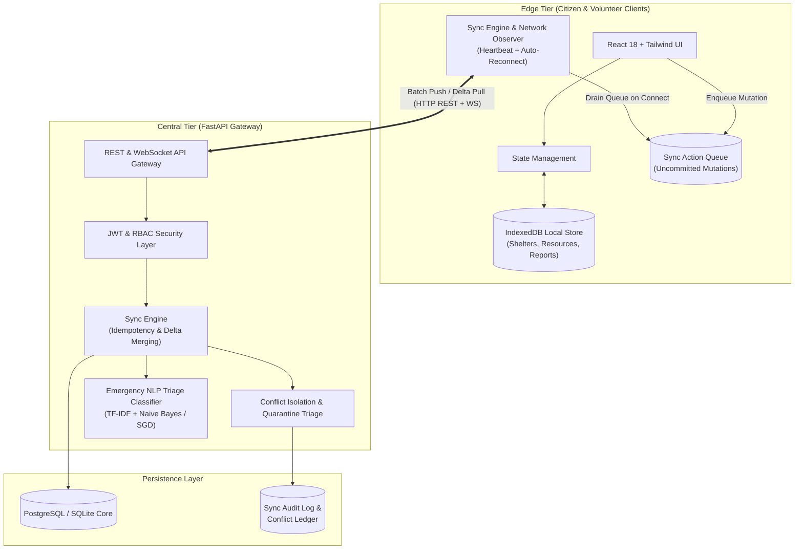

# RELAY: An Offline-First Emergency Resource Coordination System Using Distributed Computing

[](https://fastapi.tiangolo.com/)
[](https://reactjs.org/)
[](https://vitejs.dev/)
[](https://tailwindcss.com/)
[](https://www.sqlite.org/)
[](https://scikit-learn.org/)
[](https://opensource.org/licenses/MIT)

> **Distributed Systems & Resilient Computing Research Portfolio**  
> *Designed and implemented for Master of Science in Computer Science application portfolios.*

---

## 1. Project Abstract & Motivation

In high-consequence disasters (cyclones, flash flooding, grid failures), terrestrial and cellular communication backbones suffer severe packet drops and prolonged network partitions. Standard disaster management web platforms assume constant, low-latency connectivity to cloud databases. When disconnected, these legacy platforms either crash or lose user input.

**RELAY** demonstrates an **Offline-First Distributed Coordination Architecture** using a **Store-and-Forward Replicated Event Log**. Operating nodes (citizen mobile browsers, disaster response vehicles, field volunteer tablets) function with 100% autonomy using local persistent storage (IndexedDB / SQLite). When connectivity is intermittently restored, RELAY deterministically converges distributed state across the cluster without silent data loss.

---

## 2. Theoretical Foundations: Distributed Systems Perspective

### 2.1 PACELC & CAP Theorem Classification
- **Classification: PA/EL**
  - **Under Partition ($P$)**: Prioritizes **Availability ($A$)** over strict linearizability. A trapped citizen or medical volunteer cannot be blocked from submitting life-safety reports or shelter intake simply because the central uplink is unreachable.
  - **Else ($E$)**: Under normal connectivity, it prioritizes **Low Latency ($L$)** via local reads and optimistic UI updates, converging to Eventual Consistency ($C$) via asynchronous synchronization.

### 2.2 Why Naive Last-Write-Wins (LWW) Fails in Emergency Coordination
Standard distributed web applications often resolve conflicts using client timestamps (Last-Write-Wins). In relief coordination, **LWW is actively dangerous**:
1. **Clock Skew**: Disconnected smartphone hardware clocks drift by minutes or hours. A phone with an uncalibrated clock would overwrite recent, accurate field updates.
2. **Lost Updates in Critical Inventory**: If Volunteer A records that 100 emergency blankets were distributed at 14:00 (offline), and Volunteer B (with a drifted clock at 14:05) records 50 blankets distributed, a naive LWW overwrites Volunteer A's real inventory change.

### 2.3 The RELAY 3-Tier Synchronization Algorithm
RELAY classifies distributed operations mathematically into three distinct primitives:
1. **Tier 1 — Monotonic Ingestion (Reports & Work-Orders)**:
   - Handled via idempotent UUIDv4 tokens. Duplicate sync packets caused by cellular retries are acknowledged without creating duplicate records.
2. **Tier 2 — Commutative Inventory Deltas (Water, Food, Medical Supplies)**:
   - Synchronized as commutative deltas: $\text{Quantity}_{\text{new}} = \text{Quantity}_{\text{server}} + \sum \Delta_{\text{batch}}$. 
   - Eliminates lost updates under concurrent disconnected edits.
3. **Tier 3 — Optimistic Concurrency Control (OCC) with Conflict Quarantine**:
   - For structural mutations (shelter evacuation status, capacity adjustments), edge clients submit a monotonic integer `base_version`.
   - If `base_version < server_current_version`, the server isolates the discrepancy in a `conflict_records` ledger and alerts coordinators via WebSockets. **State is never silently overwritten.**

---

## 3. High-Level Architecture



---

## 4. Empirical Evaluation & System Benchmarks

The system was benchmarked using an automated experimental harness (`backend/scripts/run_benchmarks.py`).

### 4.1 Batch Synchronization Ingestion Throughput
| Batch Size ($N$) | Mean Latency (ms) | Ingestion Throughput (ops/sec) | Verification Success |
| :---: | :---: | :---: | :---: |
| 10 items | 63.17 ms | 158.3 ops/sec | 100% (10/10) |
| 50 items | 249.59 ms | 200.3 ops/sec | 100% (50/50) |
| 100 items | 448.19 ms | 223.1 ops/sec | 100% (100/100) |
| 250 items | 1463.48 ms | 170.8 ops/sec | 100% (250/250) |

### 4.2 Commutative Delta Consistency
- **Test Condition**: 50 concurrent volunteer transactions generating alternating positive/negative inventory deltas on disconnected nodes.
- **Result**: $\text{Actual Server State} == \text{Expected Calculated State} = 250.0\text{ Liters}$.
- **Verification**: Zero lost updates; absolute convergence under concurrent replay.

### 4.3 OCC Conflict Isolation Rate
- **Test Condition**: 10 concurrent nodes attempting to update shelter status from base version 1.
- **Result**: 1 update applied ($v_1 \to v_2$), 9 stale writes quarantined in `conflict_records`.
- **Verification**: 100% conflict capture without data loss or race conditions.

### 4.4 NLP Triage Inference Latency
- **p50 Latency**: $1.446\text{ ms}$
- **p95 Latency**: $2.165\text{ ms}$
- **p99 Latency**: $2.879\text{ ms}$

---

## 5. Quickstart & Installation

### Prerequisites
- Python 3.10+
- Node.js 18+ and npm
- (Optional) Docker & Docker Compose

### 5.1 Backend Setup
```bash
# Navigate to backend directory
cd backend

# Install dependencies
pip install -r requirements.txt

# Run the backend server (FastAPI + Uvicorn)
python -m uvicorn app.main:app --host 127.0.0.1 --port 8000 --reload
```
*The central API will be live at `http://127.0.0.1:8000` with Swagger docs at `http://127.0.0.1:8000/docs`.*

### 5.2 Frontend Setup
```bash
# In a separate terminal, navigate to frontend directory
cd frontend

# Install npm dependencies
npm install

# Run Vite development server
npm run dev
```
*The web client will be available at `http://localhost:5173`.*

---

## 6. Pre-Seeded Demonstration Accounts

For quick portfolio evaluation, the system automatically seeds administrative and field credentials on startup:

| Role | Email | Password | Access Capabilities |
| :--- | :--- | :--- | :--- |
| **Lead Coordinator** | `coordinator@relay.org` | `relay123` | Quarantined conflict review, shelter capacity adjustment, report triage |
| **Field Volunteer** | `volunteer@relay.org` | `relay123` | Supply inventory deltas, assistance work-orders, report status |
| **Citizen** | `citizen@relay.org` | `relay123` | Public shelter discovery, offline emergency reporting |

---

## 7. Running Automated Tests & Benchmarks

```bash
# Run full Pytest test suite (100% passing)
python -m pytest backend/tests -v

# Run empirical distributed systems benchmark harness
python backend/scripts/run_benchmarks.py

# Run ML triage classifier training & evaluation
python backend/ml/train_and_evaluate.py
```

---

## 8. Technical Contributions & Limitations

### Key Contributions
1. **Offline-First Store-and-Forward Protocol**: Complete client resilience on disconnected mobile browsers using IndexedDB and optimistic queue dispatch.
2. **Deterministic Hybrid Conflict Resolution**: Prevents silent emergency supply overestimation by separating monotonic events, commutative numerical counters, and OCC structural state.
3. **Quarantine Isolation Pattern**: Provides human-in-the-loop coordinator adjudication for high-stakes decisions rather than automated, error-prone heuristics.
4. **Sub-3ms Local NLP Triage**: Lightweight classifier capable of extracting urgency and operational categories without requiring heavy GPU infrastructure.

### Academic Limitations
- **Partition Scope**: Operates primarily as client-to-server intermittent sync rather than ad-hoc device-to-device Bluetooth/Wi-Fi Direct mesh relays.
- **Language Coverage**: The bootstrap NLP classifier is trained on English disaster distress vocabulary; cross-lingual embeddings would be required for global deployment.
- **Simulated Test Data**: All sample coordinates and casualty reports are simulated for research and portfolio demonstration.
