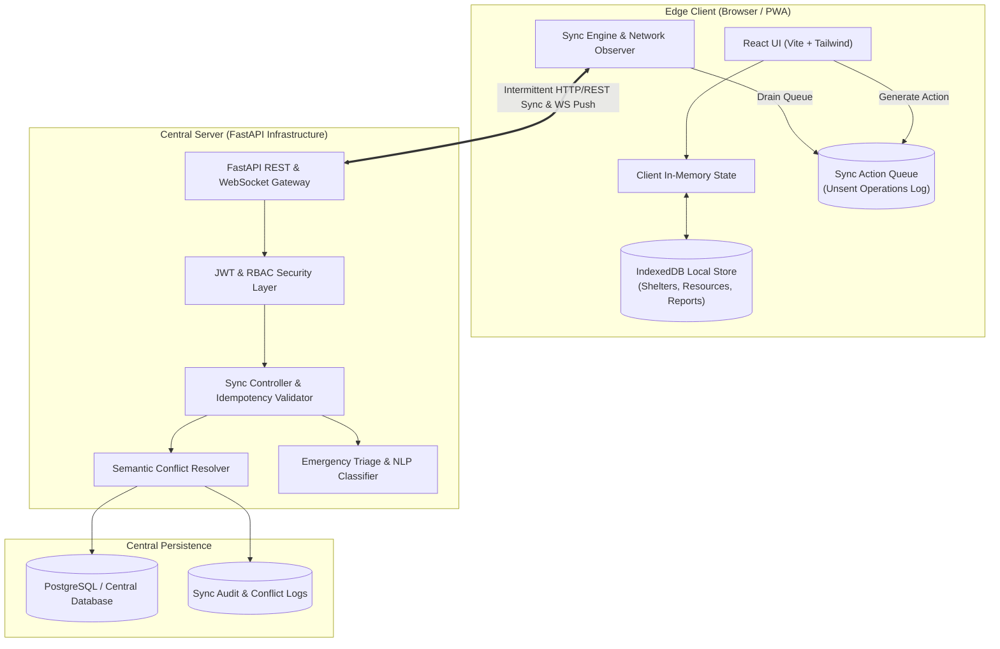

# RELAY: System Architecture & Distributed Systems Design

## 1. Executive Summary & Problem Context
In catastrophic events (floods, hurricanes, earthquakes, localized grid failures), communication backbones degrade or sever entirely. Traditional disaster response platforms fail because they presuppose continuous, reliable internet connectivity to a centralized cloud. 

**RELAY** is designed with an **Offline-First Distributed Computing Paradigm**. It treats disconnected operation not as an exceptional edge case, but as the expected normal operating state of edge devices (citizen smartphones, field volunteer tablets, emergency response vans).

```
+-------------------------------------------------------------------------------+
|                               RELAY ECOSYSTEM                                 |
+-------------------------------------------------------------------------------+
|                                                                               |
|   +-------------------+    Local Disconnect    +-------------------+          |
|   |   Citizen Client  | <--------------------> |   Volunteer Node  |          |
|   |  (IndexedDB Store)|                        |  (IndexedDB Store)|          |
|   +---------+---------+                        +---------+---------+          |
|             |                                            |                    |
|             | Intermittent 4G / Wi-Fi Sync               | Sync Uplink        |
|             v                                            v                    |
|   +----------------------------------------------------------------+          |
|   |                 RELAY Central Gateway & Reconciler             |          |
|   |           FastAPI | WebSockets | Semantic Conflict Engine      |          |
|   +----------------------------------------------------------------+          |
|             |                                            |                    |
|             v                                            v                    |
|   +-------------------+                        +-------------------+          |
|   |  Central Relational|                        | AI/ML Triage Engine|         |
|   | Database (Postgres)|                        | (Scikit-Learn/NLP)|         |
|   +-------------------+                        +-------------------+          |
|                                                                               |
+-------------------------------------------------------------------------------+
```

---

## 2. Theoretical Foundations: Distributed Systems Perspective

### 2.1 The CAP / PACELC Classification
In distributed systems theory, Brewer's CAP Theorem dictates that during a network partition ($P$), a distributed system must choose between Consistency ($C$) and Availability ($A$). The PACELC theorem extends this: **If there is a Partition ($P$), how does your system trade Availability ($A$) and Consistency ($C$); Else ($E$), how does it trade Latency ($L$) and Consistency ($C$)?**

- **RELAY Classification: PA/EL**
  - **Under Partition ($P$)**: Prioritize **Availability ($A$)** over strict Linearizability. A first responder or trapped victim cannot be blocked from logging a medical distress report or shelter intake simply because the central uplink is down. Local operations *always succeed* on local persistent storage.
  - **Else (Normal Operation, $E$)**: Prioritize **Low Latency ($L$)** via local reads and optimistic UI updates, converging to Eventual Consistency ($C$) via asynchronous synchronization.

### 2.2 Eventual Consistency & Strong Convergence
RELAY guarantees **Monotonic Read Consistency** and **Eventual Consistency**:
1. When all edge devices establish a connection and push their local change queues, all central records converge to a deterministic state.
2. Changes made locally are immediately visible to the local user (Read-Your-Writes consistency).
3. Concurrent, conflicting mutations (e.g. two volunteers allocating remaining medical supplies) are handled through **Semantic Delta Merging** and **Explicit Conflict Isolation** (never silent Last-Write-Wins overwrites).

---

## 3. High-Level Architecture Components



### 3.1 Edge Tier (Frontend Client)
- **Framework**: React 18 with Vite and Tailwind CSS.
- **Local Persistence Layer**: Browser IndexedDB (via an abstraction layer) acting as a local replica of emergency data.
- **Offline Action Queue**: An ordered, persistent log of mutations performed while disconnected (`CREATE_REPORT`, `UPDATE_INVENTORY`, `REGISTER_SHELTER`).
- **Network Observer**: Detects online/offline browser state (`navigator.onLine` + heartbeat ping) to trigger automatic synchronization when connectivity is restored.

### 3.2 Coordination Tier (FastAPI Backend)
- **Framework**: FastAPI (Asynchronous Python 3.10+).
- **Idempotency Engine**: Uses client-generated UUIDv4 tokens to ensure at-most-once processing even if network retries duplicate sync packets.
- **Optimistic Concurrency Control (OCC)**: Entities contain integer monotonic `version` fields. Updates verify that `incoming_base_version == current_server_version`.
- **Conflict Resolver**: Evaluates competing updates. Non-conflicting delta updates are merged automatically; irreconcilable conflicts (e.g. conflicting critical capacity revisions) are quarantined into `conflict_records` for coordinator review.
- **Real-Time Push**: WebSockets push synchronized updates to connected coordinator dashboards in real-time.

### 3.3 Intelligence Tier (Lightweight ML Extension)
- **Model**: Scikit-learn TF-IDF + Multinomial Naive Bayes / SGD Logistic Regression classifier.
- **Function**: Automatically classifies raw citizen emergency reports into critical priority tiers and operational categories (`MEDICAL`, `WATER`, `FOOD`, `SHELTER_NEEDED`, `INFRASTRUCTURE_HAZARD`).

---

## 4. Minimum Viable Product (MVP) Scope vs. Future Roadmap

| Feature Area | Phase 1-4 MVP Scope | Post-MVP / Extensions |
| :--- | :--- | :--- |
| **Data Connectivity** | Intermittent Client-to-Server Sync via REST & WebSockets | Multi-peer Wi-Fi Direct / Bluetooth Mesh relay |
| **Local Storage** | Browser IndexedDB with local transaction queue | Native embedded SQLite (Desktop / Mobile container) |
| **Conflict Resolution** | Semantic Delta merge + OCC + Manual Coordinator Triage Queue | Full Conflict-Free Replicated Data Types (CRDTs) |
| **Geospatial Queries** | Haversine distance computations & Leaflet map visualizer | PostGIS spatial indexing & route evacuation planning |
| **Machine Learning** | Fast NLP classification of report urgency and category | Stale report decay models & automated duplicate cluster grouping |

---

## 5. Security & Reliability Model
1. **Role-Based Access Control (RBAC)**:
   - `CITIZEN`: Can read shelters/inventory, create emergency reports, view own requests.
   - `VOLUNTEER`: Can update shelter inventory deltas, update request statuses.
   - `COORDINATOR`: Can register/close shelters, resolve quarantined conflicts, reassign resource priorities.
   - `ADMIN`: Full system management and audit log inspection.
2. **Offline Authentication Fallback**:
   - Edge clients store cryptographically signed JWT tokens with non-sensitive user profile claims locally, enabling volunteer authentication even during transient network drops.
3. **Audit Trails**:
   - Every state change originating from sync queues is logged in `sync_audit_log` with `client_device_id`, `client_timestamp`, `server_timestamp`, and `base_version` for forensic review.
