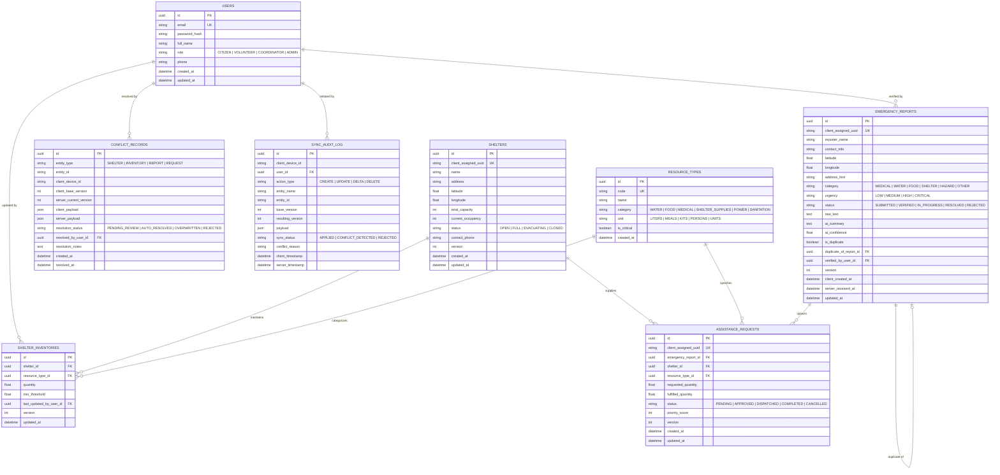

# RELAY: Database Schema & Entity Relationship Model

## 1. Entity-Relationship Overview

---

## 2. Table Specifications & Index Strategy

### 2.1 `users`
Represents system actors (citizens, field volunteers, coordinators, and administrators).
- `id` (UUID, Primary Key)
- `email` (VARCHAR(255), Unique, Indexed)
- `password_hash` (VARCHAR(255), Not Null)
- `full_name` (VARCHAR(150), Not Null)
- `role` (VARCHAR(30), Default 'CITIZEN', Indexed)
- `phone` (VARCHAR(50), Nullable)
- `created_at` (TIMESTAMP WITH TIME ZONE, Default NOW())
- `updated_at` (TIMESTAMP WITH TIME ZONE, Default NOW())

### 2.2 `shelters`
Emergency relief centers and evacuation shelters.
- `id` (UUID, Primary Key)
- `client_assigned_uuid` (VARCHAR(36), Unique, Indexed): Ensures idempotent creation when generated offline on client devices.
- `name` (VARCHAR(200), Not Null)
- `address` (VARCHAR(500), Not Null)
- `latitude` (DOUBLE PRECISION, Not Null, Indexed)
- `longitude` (DOUBLE PRECISION, Not Null, Indexed)
- `total_capacity` (INTEGER, Default 0)
- `current_occupancy` (INTEGER, Default 0)
- `status` (VARCHAR(30), Default 'OPEN', Indexed)
- `contact_phone` (VARCHAR(50))
- `version` (INTEGER, Default 1, Not Null): Monotonically increasing for Optimistic Concurrency Control.
- `created_at` (TIMESTAMP WITH TIME ZONE, Default NOW())
- `updated_at` (TIMESTAMP WITH TIME ZONE, Default NOW())

*Composite Index*: `idx_shelters_coords (latitude, longitude)` for rapid spatial bounding-box lookups.

### 2.3 `resource_types`
Controlled vocabulary of emergency survival supplies.
- `id` (UUID, Primary Key)
- `code` (VARCHAR(50), Unique, Indexed, e.g., 'POTABLE_WATER', 'MRE_RATIONS')
- `name` (VARCHAR(150), Not Null)
- `category` (VARCHAR(50), Not Null, Indexed)
- `unit` (VARCHAR(30), Not Null, e.g., 'LITERS', 'MEALS', 'KITS')
- `is_critical` (BOOLEAN, Default FALSE)
- `created_at` (TIMESTAMP WITH TIME ZONE, Default NOW())

### 2.4 `shelter_inventories`
Track current stock levels at each shelter.
- `id` (UUID, Primary Key)
- `shelter_id` (UUID, Foreign Key -> `shelters.id`, Not Null)
- `resource_type_id` (UUID, Foreign Key -> `resource_types.id`, Not Null)
- `quantity` (DOUBLE PRECISION, Default 0.0, Not Null)
- `min_threshold` (DOUBLE PRECISION, Default 10.0): Warning threshold for supply depletion.
- `last_updated_by_user_id` (UUID, Foreign Key -> `users.id`, Nullable)
- `version` (INTEGER, Default 1, Not Null)
- `updated_at` (TIMESTAMP WITH TIME ZONE, Default NOW())

*Constraint*: `UNIQUE (shelter_id, resource_type_id)` ensures each shelter has only one row per resource type.

### 2.5 `emergency_reports`
Crowdsourced and volunteer-logged distress calls.
- `id` (UUID, Primary Key)
- `client_assigned_uuid` (VARCHAR(36), Unique, Indexed)
- `reporter_name` (VARCHAR(150), Nullable)
- `contact_info` (VARCHAR(150), Nullable)
- `latitude` (DOUBLE PRECISION, Not Null, Indexed)
- `longitude` (DOUBLE PRECISION, Not Null, Indexed)
- `address_hint` (TEXT, Nullable)
- `category` (VARCHAR(50), Default 'OTHER', Indexed)
- `urgency` (VARCHAR(30), Default 'MEDIUM', Indexed)
- `status` (VARCHAR(30), Default 'SUBMITTED', Indexed)
- `raw_text` (TEXT, Not Null): Original message text reported from the field.
- `ai_summary` (TEXT, Nullable): Extracted keywords or ML summary.
- `ai_confidence` (FLOAT, Nullable): Confidence score from triage ML model.
- `is_duplicate` (BOOLEAN, Default FALSE, Indexed)
- `duplicate_of_report_id` (UUID, Foreign Key -> `emergency_reports.id`, Nullable)
- `verified_by_user_id` (UUID, Foreign Key -> `users.id`, Nullable)
- `version` (INTEGER, Default 1, Not Null)
- `client_created_at` (TIMESTAMP WITH TIME ZONE, Not Null): Timestamp recorded on device clock.
- `server_received_at` (TIMESTAMP WITH TIME ZONE, Default NOW()): Authoritative server arrival timestamp.
- `updated_at` (TIMESTAMP WITH TIME ZONE, Default NOW())

### 2.6 `assistance_requests`
Explicit operational work-orders dispatched to fulfill report needs.
- `id` (UUID, Primary Key)
- `client_assigned_uuid` (VARCHAR(36), Unique, Indexed)
- `emergency_report_id` (UUID, Foreign Key -> `emergency_reports.id`, Nullable)
- `shelter_id` (UUID, Foreign Key -> `shelters.id`, Nullable)
- `resource_type_id` (UUID, Foreign Key -> `resource_types.id`, Not Null)
- `requested_quantity` (DOUBLE PRECISION, Not Null)
- `fulfilled_quantity` (DOUBLE PRECISION, Default 0.0)
- `status` (VARCHAR(30), Default 'PENDING', Indexed)
- `priority_score` (INTEGER, Default 50)
- `version` (INTEGER, Default 1, Not Null)
- `created_at` (TIMESTAMP WITH TIME ZONE, Default NOW())
- `updated_at` (TIMESTAMP WITH TIME ZONE, Default NOW())

### 2.7 `sync_audit_log`
Immutable ledger of all client sync attempts.
- `id` (UUID, Primary Key)
- `client_device_id` (VARCHAR(100), Indexed)
- `user_id` (UUID, Foreign Key -> `users.id`, Nullable)
- `action_type` (VARCHAR(50), Not Null)
- `entity_name` (VARCHAR(50), Not Null)
- `entity_id` (VARCHAR(50), Not Null)
- `base_version` (INTEGER, Nullable)
- `resulting_version` (INTEGER, Nullable)
- `payload` (JSONB / JSON, Not Null)
- `sync_status` (VARCHAR(50), Not Null, Indexed)
- `conflict_reason` (TEXT, Nullable)
- `client_timestamp` (TIMESTAMP WITH TIME ZONE, Not Null)
- `server_timestamp` (TIMESTAMP WITH TIME ZONE, Default NOW())

### 2.8 `conflict_records`
Quarantine table storing concurrent conflicting mutations awaiting coordinator adjudication.
- `id` (UUID, Primary Key)
- `entity_type` (VARCHAR(50), Not Null, Indexed)
- `entity_id` (VARCHAR(50), Not Null, Indexed)
- `client_device_id` (VARCHAR(100), Not Null)
- `client_base_version` (INTEGER, Not Null)
- `server_current_version` (INTEGER, Not Null)
- `client_payload` (JSONB / JSON, Not Null)
- `server_payload` (JSONB / JSON, Not Null)
- `resolution_status` (VARCHAR(50), Default 'PENDING_REVIEW', Indexed)
- `resolved_by_user_id` (UUID, Foreign Key -> `users.id`, Nullable)
- `resolution_notes` (TEXT, Nullable)
- `created_at` (TIMESTAMP WITH TIME ZONE, Default NOW())
- `resolved_at` (TIMESTAMP WITH TIME ZONE, Nullable)
