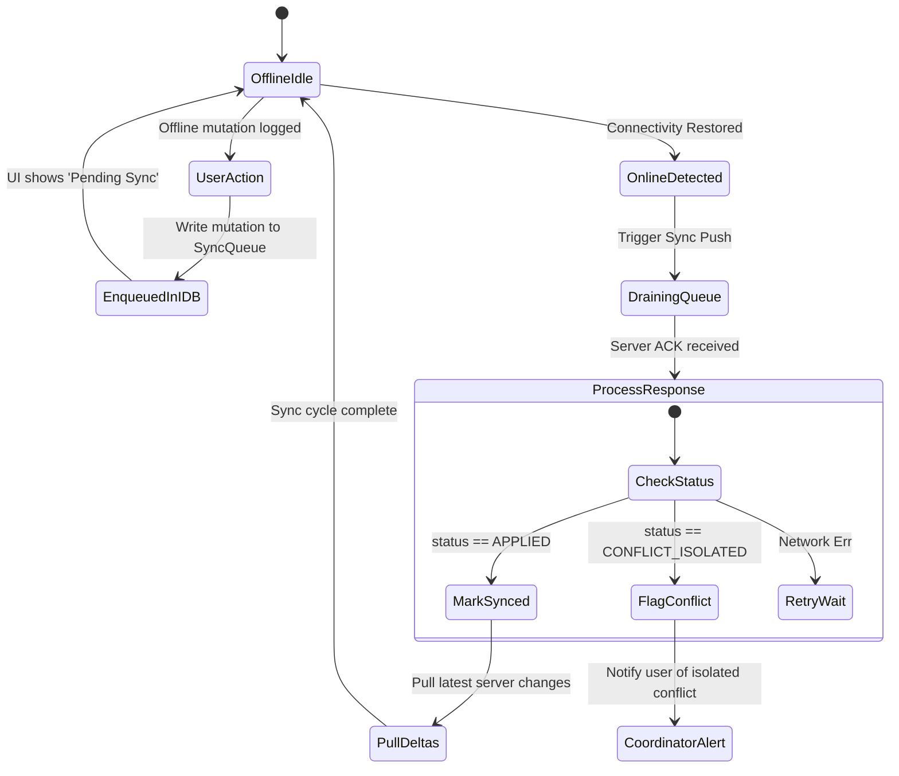

# RELAY: Synchronization Protocol & Conflict Resolution Specification

## 1. Problem Statement: Why Naive Synchronization Fails in Disasters

In a distributed disaster coordination environment, multiple volunteers and responders operate asynchronously in severed or degraded cellular zones. 

A common naive approach in web applications is **Last-Write-Wins (LWW)** using client timestamps. 
**In emergency response, LWW is actively dangerous:**
1. **Clock Skew**: Device hardware clocks drift by minutes or hours, especially on disconnected field phones. A device with a fast clock would permanently overwrite recent updates from correct devices.
2. **Lost Updates in Inventory**: 
   - Central Server has `water_liters = 500` (Version 1).
   - Volunteer A (disconnected) distributes 200 liters $\to$ sets `water_liters = 300`.
   - Volunteer B (disconnected) receives a donation of 100 liters $\to$ sets `water_liters = 600`.
   - If Volunteer A syncs first, then Volunteer B syncs via LWW, the final server count becomes 600. The distribution of 200 liters by Volunteer A is silently erased from existence, leading coordinators to believe they have double the water they actually hold!

---

## 2. RELAY Hybrid Synchronization Architecture

RELAY classifies distributed operations into three mathematical categories, applying the optimal synchronization primitive to each:

```
+-----------------------------------------------------------------------------------+
|                        RELAY OPERATION CLASSIFICATION                             |
+-----------------------------------------------------------------------------------+
| 1. Monotonic / Append-Only Events (Reports, Requests)                             |
|    ==> UUIDv4 Idempotent Append (No conflict possible)                            |
+-----------------------------------------------------------------------------------+
| 2. Numerical Commutative Quantities (Water, Food Rations, Supplies)               |
|    ==> Delta-Based Semantic Replay (Commutative updates: new = current + delta)   |
+-----------------------------------------------------------------------------------+
| 3. Structural Mutable State (Shelter Status, Capacity Limits, Coordinates)        |
|    ==> Optimistic Concurrency Control (OCC) + Quarantine Isolation Triage         |
+-----------------------------------------------------------------------------------+
```

---

## 3. The 3 Synchronization Tiers in Detail

### Tier 1: Monotonic Append-Only Operations (Reports & Requests)
- **Protocol**: When a user creates an emergency report while offline, the edge client mints a cryptographically secure `client_assigned_uuid` (UUIDv4) and timestamps it with local device time.
- **Deduplication**: When pushed to the central server, the database enforces a `UNIQUE(client_assigned_uuid)` constraint.
- **Idempotency**: If a client pushes the same batch three times due to network timeouts, the server acknowledges the existing record without duplicate insertion or error.

### Tier 2: Commutative Delta Merging (Inventory Updates)
- Rather than transmitting absolute state (`quantity = 300`), the client records a **Delta Operation**:
  ```json
  {
    "action": "INVENTORY_DELTA",
    "shelter_id": "9b1deb4d-3b7d-4bad-9bdd-2b0d7b3dcb6d",
    "resource_type_code": "WATER_LITERS",
    "delta": -200.0,
    "base_version": 4,
    "client_timestamp": "2026-11-03T18:00:00Z"
  }
  ```
- **Merge Logic**: 
  - If the server has evolved from Version 4 to Version 6 through other concurrent updates, the server safely applies the delta: $\text{Server Quantity}_{\text{new}} = \text{Server Quantity}_{\text{current}} + \Delta$.
  - **Threshold Check**: If $\text{Server Quantity}_{\text{new}} < 0$, the server clamps the quantity to $0.0$, marks the event as an audit anomaly, and notifies coordinators.

### Tier 3: OCC with Conflict Isolation (Structural Mutables)
- For attributes that cannot be treated as commutative numbers (e.g. changing Shelter status from `OPEN` to `EVACUATING`, or changing building capacity):
- The client submits:
  ```json
  {
    "action": "UPDATE_SHELTER",
    "entity_id": "9b1deb4d-3b7d-4bad-9bdd-2b0d7b3dcb6d",
    "base_version": 2,
    "payload": {
      "status": "EVACUATING",
      "total_capacity": 150
    }
  }
  ```
- **Reconciliation Algorithm**:
  1. The server reads the entity's current `version`.
  2. If `base_version == server_current_version`:
     - Apply update.
     - Increment `version` to `base_version + 1`.
     - Return status `APPLIED`.
  3. If `base_version < server_current_version`:
     - **Conflict Detected!**
     - Do NOT overwrite server state.
     - Insert an entry into `conflict_records` containing both `client_payload` and `server_payload`.
     - Return status `CONFLICT_ISOLATED` to client.
     - Dispatch WebSocket event to Coordinator Dashboard for human-in-the-loop review.

---

## 4. The Sync Wire Protocol

### 4.1 Sync Push (Client $\to$ Server)
- **Endpoint**: `POST /api/v1/sync/push`
- **Headers**: `X-Device-ID: <uuid>`, `Authorization: Bearer <jwt>`
- **Request Body**:
```json
{
  "device_id": "dev-phone-volunteer-042",
  "client_sent_at": "2026-11-03T18:30:00.000Z",
  "batch": [
    {
      "mutation_id": "c1f7a28b-59b1-4f9e-8c43-26f634d0b1a1",
      "entity_type": "REPORT",
      "action": "CREATE",
      "base_version": null,
      "payload": {
        "client_assigned_uuid": "c1f7a28b-59b1-4f9e-8c43-26f634d0b1a1",
        "reporter_name": "Elena Rostova",
        "latitude": 37.7749,
        "longitude": -122.4194,
        "category": "MEDICAL",
        "urgency": "CRITICAL",
        "raw_text": "Flooding trapped 4 elderly residents on 2nd floor, diabetic insulin needed urgently.",
        "client_created_at": "2026-11-03T18:25:00.000Z"
      }
    },
    {
      "mutation_id": "f5e8d3b2-7c1a-4f5e-9a2d-1b3c4d5e6f7a",
      "entity_type": "INVENTORY",
      "action": "DELTA",
      "base_version": 3,
      "payload": {
        "shelter_id": "9b1deb4d-3b7d-4bad-9bdd-2b0d7b3dcb6d",
        "resource_type_code": "POTABLE_WATER",
        "delta": -50.0
      }
    }
  ]
}
```

- **Response Body**:
```json
{
  "server_received_at": "2026-11-03T18:30:02.120Z",
  "processed_count": 2,
  "results": [
    {
      "mutation_id": "c1f7a28b-59b1-4f9e-8c43-26f634d0b1a1",
      "status": "APPLIED",
      "entity_id": "3a7b9c1d-...",
      "resulting_version": 1
    },
    {
      "mutation_id": "f5e8d3b2-7c1a-4f5e-9a2d-1b3c4d5e6f7a",
      "status": "APPLIED",
      "entity_id": "8e2d1c0b-...",
      "resulting_version": 4
    }
  ]
}
```

### 4.2 Sync Pull (Server $\to$ Client)
- **Endpoint**: `GET /api/v1/sync/pull?since=2026-11-03T18:00:00Z`
- Client queries all records updated across the ecosystem since its last successful synchronization checkpoint.
- Local IndexedDB store updates its snapshot accordingly.

---

## 5. Client State Machine & Life Cycle


